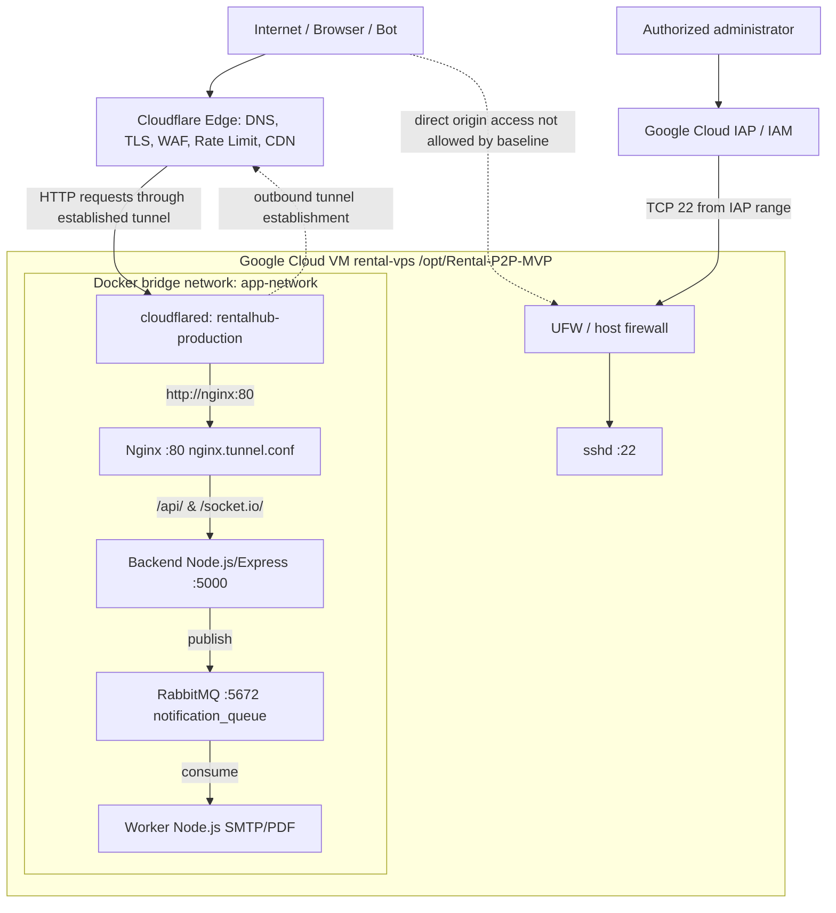

# Rental P2P — Infrastructure & Security Convention

> **Tài liệu bàn giao vận hành cho developer, DevOps và AI coding agent**  
> Baseline: **2026-11-27 (UTC+07:00)** · Môi trường public: `rental.thanquocthinh.id.vn`  
> Trạng thái: snapshot đã kiểm chứng trên VPS `rental-vps` (`/opt/Rental-P2P-MVP`), đối chiếu dashboard Cloudflare và đồng bộ với cấu hình production trong repository; không phải kết quả audit bảo mật toàn diện.  
> Vị trí chính thức trong repository: `docs/INFRASTRUCTURE.md` (single source of truth).

## 0. Quy tắc đọc tài liệu

Agent tiếp quản phải đọc hết tài liệu này trước khi đề xuất hoặc thực hiện thay đổi infrastructure, deployment, networking hay security. Không coi tài liệu là quyền tự động thay đổi production. Trạng thái thực tế trên server/dashboard có thể thay đổi sau ngày baseline.

| Nhãn | Ý nghĩa |
| --- | --- |
| **VERIFIED** | Có ảnh, output lệnh hoặc thử nghiệm do chủ dự án cung cấp trên môi trường thực tế tại thời điểm baseline. |
| **VERIFIED (REPO)** | Đã đọc trực tiếp từ source code hoặc file cấu hình trong repository; luôn đối chiếu runtime thực tế khi thao tác production. |
| **REPORTED** | Chủ dự án hoặc báo cáo Cloudflare AI Agent đã cung cấp thông tin; chưa kiểm chứng độc lập toàn bộ. |
| **INFERRED** | Suy luận hợp lý từ dữ liệu hiện có; phải đối chiếu cấu hình thật trước khi thay đổi. |
| **DRIFT** | Có sai khác rõ ràng giữa tài liệu/baseline runtime và file cấu hình trong repository; cần xác minh trên server trước khi thay đổi, không tự ý sửa ép cho khớp. |
| **TODO** | Chưa có đủ dữ liệu hoặc chưa kiểm thử. Không được coi là hoàn thành. |
| **RECOMMENDED** | Convention hoặc cấu hình đề xuất, không đồng nghĩa đã được triển khai. |

### 0.1. Tóm tắt bắt buộc

- Rental là ứng dụng public trên Google Cloud VM (hostname `rental-vps`, thư mục triển khai `/opt/Rental-P2P-MVP`), chạy Linux và Docker.
- HTTP/HTTPS public đi qua Cloudflare và Cloudflare Tunnel `rentalhub-production` (`cloudflared` chạy trong container), định tuyến nội bộ `rental.thanquocthinh.id.vn` → `http://nginx:80` trên Docker bridge `app-network`, không publish port ứng dụng ra host.
- Quản trị SSH đi qua Google Cloud IAP, chỉ cho phép TCP/22 từ dải IPv4 IAP `35.235.240.0/20` ở UFW; xác thực SSH bằng public key, không dùng password.
- Nginx (`nginx/nginx.tunnel.conf`), backend (Node.js 24 + Express 4 + Mongoose + Socket.IO, TCP/5000 nội bộ), RabbitMQ và worker không có port mapping ra host theo output `docker ps` và `docker-compose.prod.yml` đã đồng bộ.
- Certbot systemd timer và `/etc/cron.d/certbot` đã tắt/xóa trên host (`VERIFIED`).
- Cloudflare có hai WAF Custom Rules đang Active, một Rate Limiting Rule đang Active. Hai WAF rule đã được chủ dự án kiểm thử chặn HTTP 403. Rate limit chưa có bằng chứng kiểm thử HTTP 429.
- Tunnel ingress version 4 chỉ còn duy nhất route `rental.thanquocthinh.id.vn` → `http://nginx:80`; route `rental-test.thanquocthinh.id.vn` đã được xác nhận xóa (`VERIFIED`), nhưng vẫn cần xác nhận DNS record `rental-test` và wildcard DNS.
- Không mở inbound 80/443/5000/5672/15672 chỉ để deploy hoặc debug. Không dùng public SSH để thay thế IAP.
- Không thay đổi cấu hình chỉ vì có bot truy cập public. Chưa phát hiện bypass qua các cổng đã kiểm tra; chưa có bằng chứng website bị xâm nhập từ dữ liệu hiện có.

## 1. Inventory và phạm vi môi trường

| Thành phần | Giá trị / trạng thái | Bằng chứng |
| --- | --- | --- |
| Tên dự án | Rental P2P / Rental | REPORTED; container prefix `rental_p2p_` |
| Cloud provider | Google Cloud, VM Linux | VERIFIED qua SSH IAP và output server; project/zone chưa ghi nhận |
| Hostname VM | `rental-vps` | VERIFIED |
| Linux user quản trị quan sát được | `thinhskyduck` | VERIFIED; không phải thông tin cấp quyền cho agent |
| Private IPv4 VM | `10.148.0.2` | VERIFIED tại baseline; không hard-code |
| Public IP VM | Không ghi trong tài liệu | TODO xác định từ console khi kiểm tra; không dùng IP Cloudflare làm origin |
| OS distribution/version | Chưa xác nhận | TODO |
| Container runtime | Docker | VERIFIED |
| Docker Compose file / project directory | `/opt/Rental-P2P-MVP/docker-compose.prod.yml`, dùng `.env.prod` với `NGINX_CONF_FILE=nginx.tunnel.conf`; đã đồng bộ với [`docker-compose.prod.yml`](../docker-compose.prod.yml) và [`.env.prod.example`](../.env.prod.example) | VERIFIED trên VPS và VERIFIED (REPO) |
| Frontend | React 18 + Vite 8 build ra `build/` và phục vụ qua `nginx:stable-alpine` ([`frontend/Dockerfile`](../frontend/Dockerfile), [`frontend/vite.config.js`](../frontend/vite.config.js)) | VERIFIED (REPO) và khớp `/assets/index-*.js` trên production |
| Reverse proxy | Nginx container (`rental_p2p_nginx`), mount [`nginx/nginx.tunnel.conf`](../nginx/nginx.tunnel.conf) (`listen 80`, không publish port ra host, khôi phục IP thật qua `CF-Connecting-IP`) | VERIFIED trên VPS và VERIFIED (REPO); Certbot timer/cron trên host đã tắt/xóa (`VERIFIED`) |
| Backend | Node.js 24 + Express 4 + Mongoose + Socket.IO, TCP/5000 nội bộ ([`backend/server.js`](../backend/server.js), [`backend/Dockerfile`](../backend/Dockerfile)) | VERIFIED cả ở repo lẫn runtime trên `rental-vps` |
| Messaging | RabbitMQ (`rabbitmq:3.13-management-alpine`, volume `rabbitmq-data`, durable queue `notification_queue`) + Node.js worker ([`notification-worker/Dockerfile`](../notification-worker/Dockerfile), [`backend/config/rabbitmq.js`](../backend/config/rabbitmq.js), [`notification-worker/worker.js`](../notification-worker/worker.js)) | VERIFIED container tồn tại, xử lý thực tế `notification_queue` và gửi email SMTP thành công |
| Database / object storage | MongoDB Atlas ngoài container (`MONGO_URI`) và Cloudinary (`CLOUDINARY_*`) theo [`.env.prod.example`](../.env.prod.example); cluster/backup/restore production chưa audit | VERIFIED (REPO) kiến trúc; TODO xác minh production cluster, IP allowlist và backup |
| CI/CD / Deploy workflow | Không có `.github/workflows/` trong repo. Deploy thực tế trên VPS qua `/opt/Rental-P2P-MVP/deploy.sh` (untracked trên VPS): `git pull` → `docker compose -f docker-compose.prod.yml --env-file .env.prod up -d --build [service]` → `docker image prune -f` → `docker compose ps` | VERIFIED trên VPS và VERIFIED (REPO); secret mẫu trong [`.env.prod.example`](../.env.prod.example), `.env*` bị ignore trong [`.gitignore`](../.gitignore) |
| Public URL | `https://rental.thanquocthinh.id.vn` | VERIFIED |
| Cloudflare zone | `thanquocthinh.id.vn` | VERIFIED |
| Cloudflare Tunnel | `rentalhub-production` (`rental_p2p_cloudflared`); DNS `CNAME` Proxied trỏ về `<tunnel-id>.cfargotunnel.com`; ingress version 4 chỉ có 1 route `rental.thanquocthinh.id.vn` → `http://nginx:80` | VERIFIED |
| Cloudflare plan | Free (2/5 Custom Rules, 1/1 Rate Limiting Rules) | REPORTED/VERIFIED quota từ dashboard |
| Test URL cũ | `rental-test.thanquocthinh.id.vn` | VERIFIED route đã xóa khỏi Tunnel ingress v4; DNS record/wildcard TODO |

### 1.1. Đối chiếu Repository & Trạng thái đồng bộ (2026-11-27)

Phần này ghi nhận kết quả đối chiếu giữa runtime production (`rental-vps`) và mã nguồn/file cấu hình trong repository, cùng các mục drift đã được đồng bộ hoặc còn cần xác minh.

#### Tham chiếu cấu hình trong repository (`VERIFIED (REPO)`)

- Compose & môi trường mẫu: [`docker-compose.prod.yml`](../docker-compose.prod.yml), [`.env.prod.example`](../.env.prod.example), [`.gitignore`](../.gitignore).
- Dockerfiles: [`frontend/Dockerfile`](../frontend/Dockerfile), [`backend/Dockerfile`](../backend/Dockerfile), [`notification-worker/Dockerfile`](../notification-worker/Dockerfile).
- Reverse proxy: [`nginx/nginx.tunnel.conf`](../nginx/nginx.tunnel.conf) (**đang dùng trên production**); [`nginx/nginx.http.conf`](../nginx/nginx.http.conf) và [`nginx/nginx.https.conf`](../nginx/nginx.https.conf) (cấu hình Certbot/direct-TLS cũ, không dùng ở production hiện tại).
- Application runtime, auth & rate limit: [`backend/server.js`](../backend/server.js), [`backend/routes/auth.routes.js`](../backend/routes/auth.routes.js), [`backend/middleware/rateLimit.middleware.js`](../backend/middleware/rateLimit.middleware.js), [`backend/config/rabbitmq.js`](../backend/config/rabbitmq.js), [`notification-worker/worker.js`](../notification-worker/worker.js), [`frontend/vite.config.js`](../frontend/vite.config.js).
- Agent instructions & phát triển local: [`.agents/AGENTS.md`](../.agents/AGENTS.md), [`start-all.ps1`](../start-all.ps1), [`README.md`](../README.md).

#### Bảng đối chiếu & trạng thái xử lý

| Hạng mục | Trạng thái production (`VERIFIED`) | Trạng thái trong repository (`VERIFIED (REPO)`) | Trạng thái xử lý |
| --- | --- | --- | --- |
| **Docker Compose & `cloudflared`** | 5 container (`nginx`, `cloudflared`, `backend`, `worker`, `rabbitmq`) chạy trên `app-network`, `nginx` không publish port 80/443, dùng `nginx.tunnel.conf`. | [`docker-compose.prod.yml`](../docker-compose.prod.yml) đã xóa `ports: 80/443`, xóa volume Certbot, đổi mặc định sang `nginx.tunnel.conf` và thêm service `cloudflared`; [`.env.prod.example`](../.env.prod.example) đã cập nhật `NGINX_CONF_FILE=nginx.tunnel.conf` và `CLOUDFLARE_TUNNEL_TOKEN`. | **Đã đồng bộ (CLOSED).** Không còn drift Compose/ports/cloudflared. |
| **Nginx config & Client IP forwarding** | Production dùng `nginx/nginx.tunnel.conf` sau `cloudflared`; access log Nginx ghi nhận đúng IP thật của client. | [`nginx/nginx.tunnel.conf`](../nginx/nginx.tunnel.conf) đã được đồng bộ vào repo với `set_real_ip_from 172.16.0.0/12`, `real_ip_header CF-Connecting-IP`, `real_ip_recursive on`, `X-Forwarded-For $proxy_add_x_forwarded_for`, kết hợp `app.set('trust proxy', 1)` ở [`backend/server.js`](../backend/server.js). | **Đã đồng bộ (CLOSED).** Backend `express-rate-limit` và VNPay nhận đúng IP client. |
| **HSTS header trên production** | `nginx/nginx.tunnel.conf` chỉ chạy HTTP `:80` nội bộ sau Tunnel và **không** phát `Strict-Transport-Security`. Header HSTS trong bản `curl` asset cũ (`Age: 87128`) là bản cache còn lại từ cấu hình `nginx.https.conf` trước đó. | [`nginx/nginx.tunnel.conf`](../nginx/nginx.tunnel.conf) phát `X-Content-Type-Options`, `X-Frame-Options`, `Referrer-Policy` (không phát HSTS). | **TODO.** Bật/xác minh HSTS trực tiếp tại Cloudflare Edge Certificates (không bật `includeSubDomains`/preload khi chưa đánh giá toàn zone). |
| **Auth API paths & Backend Rate Limiting** | Cloudflare Rate Limiting Rule chặn `/api/auth/login` và `/api/auth/register` (`Active`; threshold và HTTP 429 còn `TODO`). | [`backend/routes/auth.routes.js`](../backend/routes/auth.routes.js) xác nhận đúng 2 route `POST /api/auth/login` và `POST /api/auth/register`. [`backend/middleware/rateLimit.middleware.js`](../backend/middleware/rateLimit.middleware.js) có `apiLimiter` (300/15m), `loginLimiter` (10/15m), `forgotPasswordLimiter` (5/15m), `uploadLimiter` (30/15m), `aiLimiter` (10/15m), và Socket.IO limiter (10 events/10s). | **Finding / TODO.** `POST /api/auth/register` chưa có limiter riêng ngoài `apiLimiter`; `/forgot-password` và `/reset-password/:token` chưa nằm trong rule Free của Cloudflare. Cần đối chiếu threshold Cloudflare và kiểm thử HTTP 429. |
| **Tài liệu local dev vs. production Docker** | Production chạy Docker tại `/opt/Rental-P2P-MVP` bằng `deploy.sh` (`VERIFIED`). | [`.agents/AGENTS.md`](../.agents/AGENTS.md) ghi nhận phát triển local Windows dùng `.\start-all.ps1`; [`README.md`](../README.md) vẫn còn hướng dẫn cũ cho `docker-compose.yml` / `docker-compose.swarm.yml` (các file này không còn tồn tại trong repo). | **DRIFT (tài liệu).** Phân biệt rõ: local dev dùng `start-all.ps1`, production dùng Docker trên `rental-vps` theo `docs/INFRASTRUCTURE.md`. |
| **Kích thước ảnh tĩnh & Swagger `/api-docs`** | Đề xuất kiểm tra cache `/img/carou-2.webp`, `/img/chupanhcanon.png` và kiểm tra `/api-docs` (`TODO`). | Trong `frontend/public/img/`: `carou-2.webp` = `1,155,896` bytes (~1.10 MB), `chupanhcanon.png` = `983,147` bytes (~960 KB), `carou-2.png` = `7,944,463` bytes (~7.58 MB). [`backend/server.js`](../backend/server.js) có mount `/api-docs`, nhưng `nginx/nginx.tunnel.conf` chỉ proxy `/api/` và `/socket.io/`. | **TODO** kiểm tra `CF-Cache-Status` và header cache của `/img/*` trên live site, tối ưu ảnh nếu được duyệt, và xác minh `/api-docs` không bị expose ra public. |

## 2. Kiến trúc và trust boundaries

### 2.1. Luồng HTTP public và luồng quản trị



Luồng chính trên production đã được xác minh (**VERIFIED**): Cloudflare Tunnel `rentalhub-production` (ingress version 4) định tuyến duy nhất `rental.thanquocthinh.id.vn` → `http://nginx:80` trên Docker bridge `app-network`; Nginx chạy [`nginx/nginx.tunnel.conf`](../nginx/nginx.tunnel.conf) phục vụ static bundle React/Vite và reverse-proxy `/api/` cùng `/socket.io/` tới `backend:5000` (Node.js 24 + Express 4); Backend publish và Worker consume `notification_queue` trên `rabbitmq:5672` và đã xác nhận gửi email SMTP thành công; cả Backend và Worker kết nối MongoDB Atlas ngoài container (`MONGO_URI`). Đường kết nối tunnel được `cloudflared` chủ động thiết lập outbound; chiều request người dùng đi qua kết nối đã thiết lập. Không nhầm hai chiều này thành yêu cầu mở inbound.

### 2.2. Security boundaries

| Boundary | Chính sách |
| --- | --- |
| Internet → Cloudflare | Public HTTPS, WAF và rate limit cho điều kiện đã định nghĩa; tài nguyên public vẫn có thể bị crawl. |
| Cloudflare → origin | Qua Tunnel `rentalhub-production`, không dùng public origin HTTP/HTTPS. |
| Admin → VM | Google IAP + SSH key; IAM phải được rà soát riêng. |
| VM → container | Docker bridge `app-network`; không publish port dịch vụ; quyền Docker là quyền nhạy cảm gần tương đương root. |
| Backend → dữ liệu | Authentication và authorization tại backend; không dựa vào WAF hay frontend để kiểm soát quyền sở hữu dữ liệu. |

## 3. Docker runtime baseline

Output đã quan sát:

```text
NAMES                    PORTS
rental_p2p_nginx         80/tcp, 443/tcp
rental_p2p_cloudflared
rental_p2p_worker
rental_p2p_backend       5000/tcp
rental_p2p_rabbitmq      4369/tcp, 5671-5672/tcp, 15671-15672/tcp, 15691-15692/tcp, 25672/tcp
```

| Container | Vai trò | Port publish ra host |
| --- | --- | --- |
| `rental_p2p_nginx` | Reverse proxy (`nginx/nginx.tunnel.conf`) & frontend static bundle | Không có |
| `rental_p2p_cloudflared` | Cloudflare Tunnel connector (`rentalhub-production`) | Không có |
| `rental_p2p_backend` | Application API (Node.js 24 + Express 4 + Socket.IO) | Không có |
| `rental_p2p_worker` | Background notification worker (RabbitMQ consumer + SMTP/PDF) | Không có |
| `rental_p2p_rabbitmq` | Message broker (`rabbitmq:3.13-management-alpine`, queue `notification_queue`) | Không có |

`80/tcp` hoặc `5000/tcp` là port được khai báo trong metadata container (khớp `EXPOSE 80 443` ở [`frontend/Dockerfile`](../frontend/Dockerfile) và `EXPOSE 5000` ở [`backend/Dockerfile`](../backend/Dockerfile)), không phải publish port ra host. Dạng `0.0.0.0:5000->5000/tcp` mới thể hiện publish port IPv4 thông thường; `[::]:...` là IPv6. Cả hai dạng publish đều không tồn tại trên production và đã được đồng bộ loại bỏ khỏi [`docker-compose.prod.yml`](../docker-compose.prod.yml).

Firewall raw cho thấy bridge `br-add5b5fff0e2`, subnet `172.18.0.0/16`, các địa chỉ container snapshot `172.18.0.2` đến `.6`. Default bridge `docker0` dùng `172.17.0.0/16`. Các giá trị này là snapshot, không phải API ổn định; không hard-code hoặc gán container IP theo thứ tự output.

### 3.1. Docker conventions

- Giữ các dịch vụ giao tiếp bằng service name / network alias trên Docker network `app-network` (`nginx`, `cloudflared`, `backend`, `worker`, `rabbitmq` theo [`docker-compose.prod.yml`](../docker-compose.prod.yml)).
- Không thêm `ports:`, `network_mode: host`, privileged mode, Docker socket mount hoặc direct routing public để xử lý lỗi tạm thời. `expose` không bắt buộc cho giao tiếp nội bộ; không nhầm với publish port.
- Nếu bắt buộc cần debug nội bộ, ưu tiên `docker exec`, log đã lọc secrets, hoặc phương án quản trị tạm thời được duyệt. Không mở RabbitMQ management ra Internet.
- Không chạy `docker compose down -v`, `docker system prune -a --volumes`, `docker volume rm`, xóa database/queue, hoặc restart toàn bộ stack nếu chưa có phê duyệt, phương án backup và rollback.
- Không thay đổi image tags, network, volumes, restart policy, healthchecks hay resource limits khi chưa đánh giá tác động lên dữ liệu và dịch vụ.
- Các bản cập nhật image, dependency và OS phải có kế hoạch kiểm thử, pin version/digest khi phù hợp (lưu ý `cloudflared` hiện dùng `cloudflare/cloudflared:latest`), và rollback; chưa xác nhận policy cập nhật định kỳ hiện hành.

### 3.2. Kiểm tra read-only

```bash
docker ps --format 'table {{.Names}}\t{{.Ports}}'
docker ps --format 'table {{.Names}}\t{{.Image}}\t{{.Status}}'
docker network ls
sudo ss -tulnp
# Chỉ chọn trường cần thiết, tránh in toàn bộ Config.Env hay command có token.
docker inspect --format '{{.Name}} {{.HostConfig.NetworkMode}} {{json .NetworkSettings.Ports}}' $(docker ps -q)
docker inspect --format '{{.Name}} {{json .NetworkSettings.Networks}}' $(docker ps -q)
docker inspect --format '{{.Name}} {{index .Config.Labels "com.docker.compose.project.working_dir"}} {{index .Config.Labels "com.docker.compose.project.config_files"}}' $(docker ps -q)
```

Các trường Compose label có thể trống. Không chạy `docker compose config` hoặc dump `docker inspect` đầy đủ vào chat/log public vì có thể lộ biến môi trường, đường dẫn nhạy cảm hoặc tunnel token.

## 4. Host networking, UFW và SSH

### 4.1. Listening sockets (VERIFIED)

| Protocol / port | Binding tại baseline | Process |
| --- | --- | --- |
| TCP 22 | `0.0.0.0:22`, `[::]:22` | sshd / systemd |
| TCP/UDP 53 | `127.0.0.53`, `127.0.0.54` | systemd-resolved |
| UDP 68 | `10.148.0.2%ens4:68` | systemd-networkd (DHCP client) |
| UDP 323 | `127.0.0.1:323`, `[::1]:323` | chronyd |
| TCP 80, 443, 5000, 5672, 15672 | Không thấy host listener | Không publish port ứng dụng |

SSH listen trên mọi interface không đồng nghĩa public SSH được phép. Firewall thực tế quyết định khả năng truy cập. Ngoài ra, trên host `rental-vps`, Certbot systemd timer và `/etc/cron.d/certbot` đã được tắt/xóa (`VERIFIED`) vì TLS public được terminate tại Cloudflare Edge.

### 4.2. UFW policy (VERIFIED)

```text
Status: active
Logging: on (low)
Default: deny (incoming), allow (outgoing), deny (routed)
New profiles: skip
```

Raw rules tại snapshot:

- IPv4 và IPv6 filter INPUT: policy DROP.
- IPv4 và IPv6 filter FORWARD: policy DROP; Docker có chain forwarding riêng và có thể ACCEPT lưu lượng hợp lệ trước khi qua UFW.
- IPv4 và IPv6 filter OUTPUT: policy ACCEPT.
- `ufw-before-input` cho phép loopback và RELATED,ESTABLISHED; có ngoại lệ giao thức hệ thống/ICMP theo UFW. Không diễn giải default deny thành chặn tuyệt đối mọi inbound packet.
- IPv4 `ufw-user-input`: có rule ACCEPT TCP/22 từ `35.235.240.0/20` (3 packet tại snapshot); IPv6 `ufw6-user-input` không thấy rule tương ứng.
- Docker NAT chain `DOCKER` không thấy DNAT publish port; có MASQUERADE outbound cho bridge.
- Docker raw PREROUTING có DROP traffic từ ngoài bridge đi trực tiếp vào IP container snapshot. `DOCKER-USER` không thấy rule riêng tại snapshot.

Lưu ý: output `ufw status verbose` ban đầu có phần bảng rule không đầy đủ trong đoạn người dùng gửi. `ufw show raw` mới cung cấp bằng chứng về rule IAP. Không suy luận UFW bị lỗi hoặc không cho phép SSH.

### 4.3. SSH / IAP (VERIFIED)

```text
SSH_CONNECTION: 35.235.240.16 44417 10.148.0.2 22
Previous login source: 35.235.240.17
```

Hai địa chỉ nguồn thuộc dải IPv4 IAP `35.235.240.0/20`. Port client 44417 là giá trị tạm thời. Effective `sshd -T`:

```text
permitrootlogin prohibit-password
pubkeyauthentication yes
passwordauthentication no
kbdinteractiveauthentication no
```

`prohibit-password` không phải `no`: root vẫn có thể đăng nhập bằng phương thức xác thực được phép, ví dụ key nếu được cấp. Không có bằng chứng root có key hợp lệ hay đã đăng nhập.

**Convention quản trị:**

- Dùng đường quản trị IAP đang hoạt động; không thêm `ufw allow 22/tcp` cho mọi nguồn, không mở SSH `0.0.0.0/0` hoặc `::/0` tại VPC.
- Giữ default deny incoming; không tắt UFW để debug. Không mở 80/443/5000/5672/15672 hoặc inbound 7844 cho Tunnel.
- Chỉ cân nhắc `PermitRootLogin no` sau khi xác nhận non-root sudo, có phiên SSH thứ hai đang hoạt động và phương án recovery. Cấu hình này chưa được triển khai.
- Trước khi chỉnh SSH/UFW, giữ phiên hiện tại, xác nhận đường khôi phục bằng Google Cloud, kiểm tra cú pháp `sudo sshd -t`, thử một phiên IAP mới; không ngắt phiên cũ cho đến khi xác nhận truy cập mới thành công.
- GCP VPC Firewall, IAM role assignments, OS Login, serial console/recovery và public IPv6 của VM chưa được kiểm tra trong dữ liệu này. Kiểm tra console theo quyền được cấp; không tự thay đổi IAM hay firewall cloud.

### 4.4. Read-only commands

```bash
hostname
cat /etc/os-release
ip -brief address
sudo ufw status verbose
sudo ufw show raw
sudo ss -tulnp
printf '%s\n' "$SSH_CONNECTION"
sudo sshd -T | grep -E '^(permitrootlogin|passwordauthentication|pubkeyauthentication|kbdinteractiveauthentication) '
sudo sshd -t
```

Không đăng công khai raw logs, public origin IP hoặc account/credential details. Đọc hiệu lực SSH theo ngữ cảnh nếu cấu hình có `Match` blocks; output global không chứng minh mọi trường hợp.

## 5. Cloudflare DNS và Tunnel

### 5.1. DNS production (VERIFIED)

`nslookup rental.thanquocthinh.id.vn 1.1.1.1` trả về:

```text
2606:4700:3036::ac43:a37e
2606:4700:3033::6815:3186
104.21.49.134
172.67.163.126
```

Đây là IP Cloudflare edge tại thời điểm kiểm tra, không phải IP origin. Không hard-code chúng; DNS edge có thể thay đổi. DNS của `rental.thanquocthinh.id.vn` đã được xác nhận là bản ghi `CNAME` Proxied trỏ về `<tunnel-id>.cfargotunnel.com` (`VERIFIED`). DNS hiện tại không trả IP origin, nhưng không đảm bảo origin chưa từng bị công khai qua nguồn khác.

### 5.2. Tunnel (VERIFIED)

- Tunnel name: `rentalhub-production` (`VERIFIED`).
- Container connector: `rental_p2p_cloudflared` (`image: cloudflare/cloudflared:latest`, `command: tunnel --no-autoupdate run`, token nạp qua `CLOUDFLARE_TUNNEL_TOKEN` trong `.env.prod` trên VPS; `VERIFIED`).
- Public hostname & ingress: Tunnel ingress version 4 chỉ còn duy nhất route `rental.thanquocthinh.id.vn` → `http://nginx:80` (HTTP nội bộ trong Docker bridge `app-network`; `VERIFIED`).
- DNS production: `CNAME` Proxied trỏ về `<tunnel-id>.cfargotunnel.com` (`VERIFIED`). Không ghi tunnel ID/token thật vào repository.
- Outbound Tunnel cần TCP/UDP 7844 tới Cloudflare theo tài liệu; giữ egress cần thiết cho DNS, cập nhật, ứng dụng và dependencies (lưu ý [`.env.prod.example`](../.env.prod.example) ghi nhận GCP Compute Engine chặn outbound TCP 25 nên SMTP worker cần cổng 587/465). Không thu hẹp outbound mà chưa inventory toàn bộ dependencies.
- Không thay Cloudflare SSL/TLS mode, Always Use HTTPS hoặc Tunnel origin request settings khi chưa xem cấu hình thật và kiểm thử. HTTPS public đang hoạt động tại Cloudflare edge; SSL/TLS mode và Edge HSTS setting vẫn cần xác nhận trên dashboard (`TODO`).

Dashboard cần kiểm tra: Cloudflare zone → DNS → Records; Zero Trust / Cloudflare One → Networks → Tunnels/Connectors → public hostname routes (tên menu có thể thay đổi). Không sao chép token vào repository.

### 5.3. Môi trường test cũ

`rental-test.thanquocthinh.id.vn`: đã xác nhận xóa khỏi Tunnel ingress version 4 (`VERIFIED`). WAF rule non-standard ports sau đó cũng đã thu hẹp về hostname production theo ảnh mới.

**TODO:** kiểm tra DNS record `rental-test` và wildcard DNS trong Cloudflare DNS dashboard, rồi xác nhận từ ngoài:

```powershell
nslookup rental-test.thanquocthinh.id.vn 1.1.1.1
```

NXDOMAIN là bằng chứng hostname không phân giải được tại resolver đó, không thay thế kiểm tra dashboard. Analytics lịch sử vẫn có thể hiển thị hostname đã xóa. Không tái public test/staging tự động; nếu tạo lại, dùng môi trường cô lập dữ liệu và access policy được duyệt (ví dụ Cloudflare Access), không dùng chung credential production tùy tiện.

## 6. Cloudflare Security Rules — baseline

Dashboard: zone → Security → Security rules. Snapshot cuối: **2/5 Custom Rules**, **1/1 Rate Limiting Rules**, cả ba Active và Action Block. Cột Events hiển thị 0 tại ảnh chụp; không suy ra chưa từng có event vì khoảng thời gian và độ trễ thống kê chưa biết.

### 6.1. Custom Rule #1 — Block vulnerability scanners

- Order: 1; Action: `Block`; Status: `Active` (VERIFIED).
- Scope: hostname production `rental.thanquocthinh.id.vn` (ảnh dashboard).
- Expression dưới đây là cấu hình đã hướng dẫn trong cuộc trao đổi, **không phải bản export từ Cloudflare**. Ảnh chỉ hiển thị mô tả rút gọn. Đối chiếu từng điều kiện trong Expression Editor trước khi chỉnh sửa hoặc tái tạo.

```text
(http.host eq "rental.thanquocthinh.id.vn" and (
    http.request.uri.path contains "/.env" or
    http.request.uri.path contains "/.git" or
    http.request.uri.path eq "/.npmrc" or
    http.request.uri.path eq "/xmlrpc.php" or
    http.request.uri.path eq "/wp-login.php" or
    http.request.uri.path eq "/wp-config.php"
))
```

Mục đích: chặn một số đường dẫn phổ biến dùng để dò file nhạy cảm và WordPress không liên quan đến ứng dụng. Không khẳng định bao phủ toàn bộ path encoding, case variation hay kỹ thuật tấn công; không dùng làm biện pháp thay cho không triển khai secret files và bảo mật backend.

Chủ dự án xác nhận đã kiểm thử các đường dẫn bị chặn với HTTP 403; danh sách từng response và Ray ID chưa được ghi lại.

### 6.2. Custom Rule #2 — Block non-standard ports

- Order: 2; Action: `Block`; Status: `Active` (VERIFIED).
- Rule ban đầu áp dụng cả `rental` và `rental-test`, sau đó sửa về hostname production sau khi xóa route test (ảnh cuối hiển thị `http.host eq`).
- Expression hiện hành dự kiến theo cấu hình được hướng dẫn và mô tả rút gọn; cần export đầy đủ nếu muốn tái tạo chính xác:

```text
(http.host eq "rental.thanquocthinh.id.vn" and not cf.edge.server_port in {80 443})
```

Mục đích: chặn HTTP/HTTPS request tới hostname Rental qua cổng edge không phải 80/443, ví dụ 2087, 2083, 2053. Đây là chặn L7 trên Cloudflare edge, không phải đóng TCP listener trên Cloudflare anycast IP, và không phải quy tắc firewall origin. Chủ dự án báo HTTP 403 khi kiểm thử các rule; chưa lưu từng output riêng.

### 6.3. Rate Limiting Rule — Protect Authentication API

| Thuộc tính | Trạng thái |
| --- | --- |
| Order | 1 trong nhóm Rate Limiting Rules |
| Name | `Protect Authentication API` |
| Action | `Block` (VERIFIED) |
| Status | `Active` (VERIFIED) |
| Path filter | `/api/auth/login`, `/api/auth/register` (VERIFIED từ dashboard; khớp [`backend/routes/auth.routes.js`](../backend/routes/auth.routes.js) `VERIFIED (REPO)`) |
| Counting characteristic | IP theo giới hạn Free; chưa xem trang edit rule |
| Requests / period | **TODO** xác nhận actual setting |
| Mitigation duration | **TODO** đối chiếu edit rule; Free hỗ trợ 10 giây theo tài liệu |
| Functional verification | **TODO** xác nhận HTTP 429 / security event trên production |

Expression tương ứng với mô tả trên ảnh:

```text
(http.request.uri.path in {"/api/auth/login" "/api/auth/register"})
```

Baseline đề xuất trước đó (không phải cấu hình đã xác nhận): 10 requests / 10 seconds, per IP, Block 10 seconds. Kiểm tra edit rule trước khi điều chỉnh. Cloudflare Free tại ngày đối chiếu hỗ trợ Path và Verified Bot trong expression, IP counting, một rule và mitigation timeout 10 giây. Không thêm hostname/method nếu plan không hỗ trợ; rule hiện tại có thể ảnh hưởng endpoint trùng path tại các hostname khác cùng zone. Hai path cùng rule và IP counting có thể dùng chung ngân sách request; không mặc định có bộ đếm riêng cho từng endpoint.

**Đối chiếu backend & Client IP (`VERIFIED`):** Trong [`backend/routes/auth.routes.js`](../backend/routes/auth.routes.js) và [`backend/middleware/rateLimit.middleware.js`](../backend/middleware/rateLimit.middleware.js), backend có `apiLimiter` (300 req/15 phút trên toàn `/api`), `loginLimiter` (10 req/15 phút trên `POST /api/auth/login`), `forgotPasswordLimiter` (5 req/15 phút trên `POST /api/auth/forgot-password` và `PUT /api/auth/reset-password/:token`), `aiLimiter` (10 req/15 phút trên `POST /api/auth/verify-ekyc`), và `uploadLimiter` (30 req/15 phút). `POST /api/auth/register` hiện chỉ đi qua `apiLimiter`. Trên production, [`nginx/nginx.tunnel.conf`](../nginx/nginx.tunnel.conf) đã cấu hình `set_real_ip_from 172.16.0.0/12`, `real_ip_header CF-Connecting-IP`, `real_ip_recursive on` và `X-Forwarded-For $proxy_add_x_forwarded_for`, kết hợp `app.set('trust proxy', 1)` trong [`backend/server.js`](../backend/server.js); access log Nginx đã xác nhận ghi đúng IP thật của client (`VERIFIED`).

**Convention:** kiểm tra frontend DevTools → Network hoặc API contract thực tế (path, case, trailing slash, request method). Giữ rate limiting/lockout phù hợp tại backend, kết hợp per-account và per-IP khi cần, chống credential stuffing phân tán; không chỉ dựa vào Cloudflare.

### 6.4. Các thiết lập khác — chưa xác nhận

| Thiết lập | Trạng thái / convention |
| --- | --- |
| Bot Fight Mode | TODO. Chưa có ảnh hoặc xác nhận đã bật. Tác động toàn domain; có thể challenge API clients, không tạo ngoại lệ bằng Custom Rules cho Bot Fight Mode Free. Chỉ bật sau khi đánh giá/test. |
| Free Managed Ruleset | TODO kiểm tra hiệu lực thực tế trên dashboard; không coi toàn bộ rule mặc định đã audit. |
| DDoS protection | Nền tảng Cloudflare cung cấp lớp bảo vệ; không có bằng chứng audit cấu hình riêng của zone. |
| Under Attack Mode | Không được xác nhận đã bật; không khuyến nghị bật vì burst nhỏ nếu không có lý do vận hành. |
| Country/ASN/IP block | Không có rule riêng được ghi nhận ngoài hai Custom Rules; không chặn hàng loạt quốc gia theo báo cáo bot. |
| Cloudflare Access | Không có bằng chứng cấu hình; cân nhắc khi tái tạo môi trường private/test. |
| SSL/TLS mode / HSTS setting ở edge | **TODO.** [`nginx/nginx.tunnel.conf`](../nginx/nginx.tunnel.conf) hiện không phát `Strict-Transport-Security`; cần bật/xác minh HSTS trực tiếp tại Cloudflare Edge Certificates (không bật `includeSubDomains`/preload khi chưa đánh giá toàn zone). |
| DNSSEC / API token scopes / account MFA | TODO. |
| Cache Rules / Page Rules / Workers / Transform Rules | TODO inventory; cache HIT không chứng minh có custom Cache Rule. |

Giữ ba slot Custom Rules còn trống cho nhu cầu đã chứng minh. Không tự nâng plan, mua add-on, đổi nameserver, reset WAF hoặc áp dụng rule rộng toàn zone khi chưa được chủ dự án duyệt.

## 7. CDN, frontend caching và HTTP security headers

### 7.1. Bằng chứng cache asset (VERIFIED — snapshot trước khi chuyển `nginx.tunnel.conf`)

Request `curl.exe -I https://rental.thanquocthinh.id.vn/assets/index-Y6DIjNv1.js` lúc `2026-11-27 02:57:46 UTC` trả về:

```http
HTTP/1.1 200 OK
Content-Type: application/javascript
Cache-Control: public, max-age=31536000, immutable
ETag: W/"6b0316ae-26be0f"
Expires: Fri, 26 Nov 2027 02:45:37 GMT
Last-Modified: Sun, 22 Nov 2026 16:22:06 GMT
Server: cloudflare
Vary: Accept-Encoding
Age: 87128
CF-Cache-Status: HIT
Strict-Transport-Security: max-age=31536000
X-Content-Type-Options: nosniff
X-Frame-Options: SAMEORIGIN
Referrer-Policy: strict-origin-when-cross-origin
Alt-Svc: h3=":443"; ma=86400
```

`Age: 87128` tương đương khoảng 24 giờ 12 phút; không phải TTL còn lại. Browser/origin cache header `max-age=31536000` tương đương một năm; không chứng minh Cloudflare edge TTL đúng một năm hoặc mọi POP đều HIT. `immutable` phù hợp với asset content-hash; filename cụ thể sẽ thay đổi khi build.

**Lưu ý quan trọng về HSTS:** Header `Strict-Transport-Security: max-age=31536000` xuất hiện trong output `curl` ở trên là **bản cache Cloudflare còn lưu từ cấu hình `nginx/nginx.https.conf` trước đó** (`Age: 87128`). Cấu hình [`nginx/nginx.tunnel.conf`](../nginx/nginx.tunnel.conf) đang chạy trên production hiện **không** phát `Strict-Transport-Security`, vì vậy sau khi asset/response mới đi qua origin sẽ không còn HSTS trừ khi được bật tại Cloudflare Edge Certificates (xem mục 7.3 và mục 12).

Request HEAD trang chủ ở cuộc trao đổi trước ghi nhận HTTP 200, `Cache-Control: no-cache`, `CF-Cache-Status: DYNAMIC` (REPORTED; khớp cấu hình `location = /index.html` trong [`nginx/nginx.tunnel.conf`](../nginx/nginx.tunnel.conf), nhưng không suy ra mọi trang HTML/API có cùng chính sách).

### 7.2. Cache convention

| Resource | Convention (RECOMMENDED, trừ asset đã kiểm tra) |
| --- | --- |
| Hashed JS/CSS/assets | Cache dài, immutable khi URL đổi theo nội dung. |
| HTML entrypoint / index.html | Revalidate hoặc TTL ngắn; không cache immutable một năm. |
| Public image files | Có cache phù hợp; kiểm tra versioning, kích thước và Content-Type. |
| Login/register, account, private API, token response | Không shared-cache dữ liệu riêng tư; dùng `private`/`no-store` phù hợp. |
| Public API | Chỉ cache có chủ đích sau khi xác nhận response không chứa dữ liệu theo user, auth hoặc cookie và cache key đúng. |

Không bật Cache Everything cho toàn site. Không purge toàn zone chỉ để debug một asset; ưu tiên URL cụ thể nếu cần. Không coi Cache HIT là chứng minh origin an toàn hoặc toàn bộ response của site đã được cache.

Kiểm tra file ảnh đã xuất hiện trong báo cáo: `/img/carou-2.webp` (`1,155,896` bytes trong repo), `/img/chupanhcanon.png` (`983,147` bytes trong repo; lưu ý repo còn có `frontend/public/img/carou-2.png` nặng `7,944,463` bytes). Tối ưu ảnh theo nhu cầu thực tế sau khi được duyệt; chưa xác nhận `CF-Cache-Status` và header thực tế của chúng trên production.

### 7.3. Security headers

- [`nginx/nginx.tunnel.conf`](../nginx/nginx.tunnel.conf) hiện phát 3 header `X-Content-Type-Options: nosniff`, `X-Frame-Options: SAMEORIGIN`, `Referrer-Policy: strict-origin-when-cross-origin` ở cấp `server`, `/assets/` và `/index.html` (`VERIFIED`).
- **HSTS (`TODO`):** [`nginx/nginx.tunnel.conf`](../nginx/nginx.tunnel.conf) không phát `Strict-Transport-Security` (do Nginx chỉ nhận HTTP `:80` nội bộ sau Cloudflare Tunnel; header HSTS trong bản curl cũ thuộc bản cache từ `nginx.https.conf`). Cần bật và xác minh HSTS trực tiếp tại **Cloudflare Edge Certificates**; **không** bật `includeSubDomains` hoặc `preload` khi chưa đánh giá toàn bộ các subdomain trong zone `thanquocthinh.id.vn`.
- Chưa kiểm tra Content-Security-Policy, Permissions-Policy, cookie flags hoặc CORS thực tế trên production (trong repo [`backend/server.js`](../backend/server.js) dùng `FRONTEND_URL` làm CORS allowlist và cho phép request không có header `Origin`); không áp dụng CSP/cross-origin policy phá vỡ frontend nếu chưa kiểm thử.
- Kiểm tra header tại HTML, API public, API private và auth response riêng. HSTS không thay thế quản trị TLS/Tunnel an toàn.

## 8. Bối cảnh sự cố bot ngày 27/11/2026

Nguồn: báo cáo Cloudflare AI Agent do chủ dự án dán vào cuộc trao đổi, không có raw HTTP request logs để tái lập toàn bộ số liệu. Các số dưới đây là **REPORTED**, không phải audit độc lập.

| Khoảng thời gian (VN) | Báo cáo |
| --- | --- |
| 27/11 02:00–03:00 (26/11 19:00 UTC) | 245 requests, 25.2 MB, 15 IP / 7 quốc gia, 24 visits; khoảng 49% bandwidth cửa sổ được báo cáo |
| 25/11 23:00 | 353 requests; hai IP Hà Lan nổi bật, dấu hiệu quét tuần tự theo agent |
| 26/11 23:00 | 207 requests; có IP VN và IP Romania theo agent |
| 26/11 21:00 | Request tới cổng 2087/2083/2053; dấu hiệu dò cổng HTTP edge |
| 27/11 07:00–08:00 | 50 requests theo agent |

Dấu hiệu: request đến `/xmlrpc.php`, `/.npmrc`, `/login`, `/register`, `/api/items`, `/api/items/categories`, `/api/items/bestsellers`, và tải lại bộ assets. Ba tài nguyên chiếm nhiều bandwidth trong burst: JS `7.97 MB`, `carou-2.webp` `5.78 MB`, `chupanhcanon.png` `4.92 MB` (tổng transfer theo báo cáo, không phải kích thước từng file). Pageview theo ảnh: Netherlands 58, India 45, Romania 41, Singapore 11, UK 9, US 9, Vietnam 6, Australia 4, Hong Kong 3. Đây là pageviews, không đồng nhất với requests hoặc unique users.

Đánh giá: traffic automation/crawling và dò quét là giả thuyết hợp lý; không đủ bằng chứng chứng minh bot có tổ chức, headless browser, scraping chủ đích, DDoS hoặc compromise. UA Linux không chứng minh headless. IP geo không xác định danh tính người vận hành. HTTP 200 có thể chỉ là SPA fallback chứ không phải leak file. `securityAction=unknown` không chứng minh không có WAF. Các status agent liệt kê chỉ cộng 189/245 và có HTTP 499 dù nói không có 4xx; không dùng báo cáo đó làm nguồn chính xác tuyệt đối.

Hành động đã thực hiện sau sự cố: tạo hai Custom Rules, kiểm thử 403, xóa route test, kiểm tra CDN HIT, DNS, Docker, host ports, UFW/IAP, tạo Rate Limiting Rule. Không có bằng chứng đã bật Bot Fight Mode. Không có bằng chứng đã xảy ra xâm nhập hoặc mất dữ liệu.

## 9. Runbook kiểm tra định kỳ và sau thay đổi

Mọi lệnh trong mục này là kiểm tra/đọc trạng thái hoặc gửi HTTP request kiểm thử. Chạy trên hệ thống được chủ dự án cho phép. Không thực hiện load test, scan diện rộng, thử mật khẩu thật hoặc thao tác dữ liệu production không được duyệt.

### 9.1. Public DNS và HTTP (Windows PowerShell, từ mạng ngoài VM)

```powershell
$base = 'https://rental.thanquocthinh.id.vn'
nslookup rental.thanquocthinh.id.vn 1.1.1.1
curl.exe -I --max-time 10 "$base/"
curl.exe -I --max-time 10 "$base/.npmrc"
curl.exe -I --max-time 10 "$base/xmlrpc.php"
curl.exe -I --max-time 10 'https://rental.thanquocthinh.id.vn:2087/'
```

Kỳ vọng: trang chủ phản hồi thành công (hoặc redirect hợp lệ nếu cấu hình thay đổi), các path dò quét và HTTP qua non-standard port bị WAF block 403. Nếu timeout ở port 2087, kiểm tra thêm mạng client và Security Events, không tự quy là WAF block. Ghi lại status, CF-Ray và timestamp; đối chiếu đúng rule/action trong Cloudflare Security Events. `HEAD` không thay thế kiểm thử chức năng bằng `GET`/`POST` khi cần.

### 9.2. Test cache

```powershell
# Thay tên file bằng hashed asset đang được trang hiện tại tham chiếu.
curl.exe -I --max-time 10 "$base/assets/index-Y6DIjNv1.js"
curl.exe -I --max-time 10 "$base/img/carou-2.webp"
curl.exe -I --max-time 10 "$base/img/chupanhcanon.png"
```

Kỳ vọng asset tồn tại trả 200 và Content-Type chính xác; HIT có thể xuất hiện sau warm-up. MISS không mặc nhiên là lỗi; DYNAMIC/BYPASS cần đối chiếu header và rule. Asset hash cũ có thể đã bị xóa ở build mới, không chẩn đoán lỗi cache chỉ từ URL baseline.

### 9.3. Kiểm tra origin bypass

Lấy **IP public thật của VM** từ Google Cloud Console, không lấy IP DNS Cloudflare và không mặc định IP egress NAT là IP inbound của VM. Nếu VM không có public IP, ghi nhận điều đó và kiểm tra VPC/private routing phù hợp; không gán public IP chỉ để test.

```powershell
$ip = 'REPLACE_WITH_AUTHORIZED_VM_PUBLIC_IP'
foreach ($port in @(22, 80, 443, 5000, 5672, 15672)) {
    Test-NetConnection -ComputerName $ip -Port $port -WarningAction SilentlyContinue |
        Select-Object RemotePort, TcpTestSucceeded
}
```

**Baseline do chủ dự án cung cấp:** cả 22, 80, 443, 5000, 5672, 15672 đều `False`. Giá trị thật của `$ip` không xuất hiện trong output; kết luận phụ thuộc việc `$ip` đúng là IP origin. `False` cho biết không kết nối được từ mạng test ở thời điểm đó, không chứng minh mọi đường truy cập đều bị chặn. Kiểm tra IPv6 origin nếu được cấp public IPv6; không nhầm IPv6 Cloudflare edge với origin.

Nếu kết nối trực tiếp tới cổng web origin thành công ngoài dự kiến, dừng thay đổi và kiểm tra firewall cloud/host, Docker bindings, Tunnel routes. Chỉ trên origin thuộc quyền quản trị, có thể kiểm tra HTTP host routing bằng `curl.exe --resolve` và GET/HEAD vô hại; không gửi token/credential thật qua đường trực tiếp chưa được xác minh. Không cố tạo lỗ mở để tái hiện bypass.

### 9.4. Kiểm thử Rate Limiting

1. Mở trang edit rule, ghi nhận exact expression, threshold, window, mitigation timeout và counting characteristic.
2. Xác nhận URL/method thực tế qua frontend DevTools hoặc API contract; test đăng nhập hợp lệ một lần bằng test account được phép, tránh lock tài khoản người dùng thật.
3. Thực hiện test có giới hạn trong môi trường kiểm thử được duyệt hoặc cửa sổ bảo trì; dùng test request không tạo tài khoản/dữ liệu thật. Không brute-force hoặc flood production. Kiểm tra số request vượt ngưỡng tối thiểu cần thiết, status 429 (hoặc response chặn được cấu hình), CF-Ray và event đúng rule. Nếu backend trả 429 trước Cloudflare (Express `express-rate-limit` trả JSON `{ message }` và header `RateLimit`), phân biệt nguồn bằng log/event.
4. Chờ mitigation hết hạn, xác nhận truy cập hợp lệ trở lại; ghi nhận false positive, NAT/shared IP và ảnh hưởng các hostname khác.

Rate limiting chưa được kiểm thử trong dữ liệu baseline. Không đánh dấu PASS chỉ vì rule Active.

### 9.5. SSH/IAP và Tunnel smoke test

```bash
printf '%s\n' "$SSH_CONNECTION"
sudo ufw status verbose
sudo ss -tulnp
docker ps --format 'table {{.Names}}\t{{.Status}}\t{{.Ports}}'
# Đọc log ngắn, lọc/redact dữ liệu nhạy cảm trước khi gửi ra ngoài.
docker logs --since 15m --tail 100 rental_p2p_cloudflared
```

Đối chiếu connector health trong dashboard và kiểm tra một phiên SSH IAP mới nếu cần thay đổi quản trị. Không restart connector chỉ vì log có transient reconnect; xác nhận URL thật và tình trạng connector trước.

### 9.6. Kiểm tra chức năng ứng dụng sau deploy

- Trang chủ, assets, navigation SPA, đăng nhập/đăng xuất, đăng ký bằng test account được phép.
- API public, API cần authentication, authorization theo role/ownership, lỗi không tiết lộ stack trace/secrets.
- Luồng thuê/trả, thanh toán (VNPay), messaging (Socket.IO) hoặc notification (RabbitMQ/email PDF) nếu thực sự có trong hệ thống: test theo contract và dữ liệu test được duyệt, không phát sinh transaction thật ngoài ý muốn.
- Backend/worker/RabbitMQ health, queue backlog và lỗi; database/backup theo quy trình thực tế.
- Không xem việc trang chủ HTTP 200 là đủ để kết luận deploy thành công.

## 10. Agent change-management convention (bắt buộc)

### 10.0. Nguyên tắc bảo toàn kiến trúc bảo mật (Security Invariants)

Mọi developer và AI Agent tiếp quản dự án bắt buộc phải tuân thủ các bất biến sau trừ khi có thay đổi được chủ dự án phê duyệt rõ ràng:

- Public application traffic phải đi qua Cloudflare Tunnel.
- Không publish trực tiếp các cổng Nginx, Backend, RabbitMQ hoặc các dịch vụ nội bộ ra Internet.
- Không tạo đường truy cập bypass Cloudflare.
- Không mở SSH public để thay thế Google Cloud IAP.
- Không vô hiệu hóa UFW, Cloudflare WAF hoặc Rate Limiting để xử lý lỗi tạm thời.
- Không bật lại môi trường `rental-test` hoặc tạo public hostname mới khi chưa được phê duyệt.
- Không bật Cache Everything cho toàn bộ website hoặc cache dữ liệu xác thực và dữ liệu cá nhân.
- Không xóa Docker volumes, database, persistent storage hoặc message queue data khi chưa được phê duyệt.
- Không thay đổi production secrets, credentials hoặc tunnel tokens khi chưa được phê duyệt.
- Không thực hiện restart, redeploy hoặc các thao tác có khả năng làm gián đoạn production ngoài phạm vi công việc được yêu cầu.

### 10.1. Trước khi thay đổi

1. Đọc tài liệu này, repository, Compose/deployment config thực tế tại `/opt/Rental-P2P-MVP` và các hướng dẫn riêng của dự án ([`.agents/AGENTS.md`](../.agents/AGENTS.md)).
2. Xác định môi trường, hostname, GCP project/zone, service đích và quyền được cấp; không đoán production path hay secret.
3. Thực hiện kiểm tra read-only trước; nêu rõ khác biệt so với baseline, rủi ro, phạm vi thay đổi và tiêu chí thành công.
4. Lưu snapshot cấu hình cần thiết ở nơi bảo mật, redact credentials; nếu có rủi ro dữ liệu phải xác nhận backup có thể restore.
5. Đề xuất change nhỏ nhất, thứ tự thao tác và rollback cụ thể. Xin phê duyệt trước khi thay đổi production, firewall, IAM, DNS, Tunnel, WAF, secrets, persistent data, image/deploy hoặc bất kỳ action gây downtime/chi phí.

### 10.2. Trong khi thay đổi

- Một nhóm thay đổi logic tại một thời điểm; không chỉnh nhiều lớp đồng thời khiến khó xác định nguyên nhân lỗi.
- Không in secret, SSH private key, Cloudflare API token, tunnel token, JWT signing key, DB password, RabbitMQ credential, `.env` / `.env.prod` hoặc PII ra chat, commit, command log hay tài liệu.
- Không dùng wildcard allow, tắt auth, bỏ kiểm tra TLS, tắt WAF/UFW hoặc thêm public ports như cách fix mặc định.
- Không chạy lệnh destructive hoặc migration không có kiểm soát. Không tự động xóa record/rule “không dùng” nếu chưa chứng minh không ảnh hưởng service khác.
- Thay đổi có ảnh hưởng chung toàn zone (Bot Fight Mode, cache, DNS, rate limit) phải đánh giá cả hostname khác ngoài Rental.

### 10.3. Sau khi thay đổi

- Chạy smoke tests ở mục 9 phù hợp với phạm vi, xác nhận SSH/IAP và public HTTP còn hoạt động, kiểm tra Security Events và log ứng dụng.
- So sánh trước/sau về port mapping, firewall, response code và cache theo nhu cầu; nếu vi phạm security invariant hoặc chức năng chính, rollback theo kế hoạch đã duyệt.
- Cập nhật tài liệu này và cấu hình source of truth nếu được phép; không chỉ sửa tay dashboard mà bỏ qua IaC/Compose nếu hệ thống đang quản lý bằng code.
- Ghi rõ những gì đã thay đổi, bằng chứng, phần chưa kiểm tra; không báo “secure 100%”, “đã fix toàn bộ” nếu chỉ kiểm tra một số cổng hoặc rule.

### 10.4. Deploy & Rollback guidance

**Quy trình deploy hiện hành trên VPS (`VERIFIED`):** Tại `/opt/Rental-P2P-MVP`, chạy script `/opt/Rental-P2P-MVP/deploy.sh` (hiện untracked trên VPS), thực hiện lần lượt:
1. `git pull`
2. `docker compose -f docker-compose.prod.yml --env-file .env.prod up -d --build [service]`
3. `docker image prune -f`
4. `docker compose ps`

| Loại thay đổi | Rollback nguyên tắc |
| --- | --- |
| WAF / rate limit | Khôi phục expression/action/order/threshold snapshot; nếu cần disable rule mới gây lỗi thì phải được duyệt, không tắt toàn bộ WAF. |
| DNS / Tunnel | Khôi phục record/route cũ đã ghi nhận, xác nhận connector health, DNS propagation và URL. Không tạo public origin mapping. |
| Docker / application | Checkout lại commit/tag đã biết hoạt động tại `/opt/Rental-P2P-MVP` và rebuild bằng `docker compose -f docker-compose.prod.yml --env-file .env.prod up -d --build [service]`; giữ nguyên persistent volumes (`rabbitmq-data`); migration rollback phải có quy trình riêng. Lưu ý `deploy.sh` có `docker image prune -f` nên cần xác định trước commit ổn định để rebuild khi rollback. |
| SSH / firewall | Giữ phiên quản trị cũ và đường recovery, khôi phục rule/config cụ thể; không reset toàn bộ firewall tùy tiện. |
| Cache | Khôi phục header/rule cũ, purge URL bị ảnh hưởng nếu cần; không purge toàn zone mặc định. |

### 10.5. Quy trình 10 bước duy trì tài liệu

Sau mỗi thay đổi liên quan đến hạ tầng, agent bắt buộc thực hiện theo thứ tự:

1. Đọc infrastructure baseline (`docs/INFRASTRUCTURE.md`).
2. Kiểm tra trạng thái thực tế bằng lệnh read-only.
3. Xác định phạm vi ảnh hưởng.
4. Đề xuất phương án thay đổi (mục đích, tác động, rủi ro, bước xác minh).
5. Xác định phương án rollback cụ thể.
6. Nhận phê duyệt rõ ràng trước khi thay đổi production.
7. Thực hiện thay đổi trong đúng phạm vi được phê duyệt.
8. Kiểm thử và xác minh kết quả thực tế.
9. Cập nhật `docs/INFRASTRUCTURE.md` theo trạng thái **đã triển khai và đã xác minh** (không ghi cấu hình dự kiến như thể đã triển khai).
10. Ghi changelog (mục 14) và cập nhật các vấn đề/hạng mục chưa được xác minh (mục 12).

## 11. Operational triage

| Triệu chứng | Thứ tự kiểm tra | Không làm mặc định |
| --- | --- | --- |
| Website không truy cập được | DNS → Cloudflare HTTP status/Ray ID → Tunnel health → Nginx → backend/dependencies | Mở port 80/443 hoặc tắt firewall |
| HTTP 403 trên URL hợp lệ | Xác định edge/origin response → Security Events → rule match → auth tại backend | Tắt cả WAF hoặc whitelist mọi IP |
| HTTP 429 / 1015 | Rate limit event, exact path, IP, window; kiểm tra backend throttling (`express-rate-limit` & `CF-Connecting-IP`) | Nới threshold vô hạn |
| HTTP 502/504 hoặc lỗi Tunnel | Connector, upstream service name/port, network, container state và log | Publish backend ra host |
| SSH không kết nối | IAP permission/console, VPC ingress, UFW rule IAP, sshd, recovery | Mở SSH toàn Internet |
| Bot spike | Request path/method/status, edge vs origin, rate, bandwidth, IP/ASN/UA; so sánh baseline | Chặn toàn quốc gia, Under Attack Mode chỉ vì một burst nhỏ |
| Asset stale / lỗi cache | HTML version, hashed filenames, Content-Type, Cache-Control, CF-Cache-Status | Cache Everything hoặc purge toàn zone ngay |
| Nghi dữ liệu bị lộ | Bảo toàn log, thông báo chủ dự án, xác định phạm vi và credential exposure, containment được duyệt | Xóa log, tự reset database hoặc kết luận chỉ từ HTTP 200 |

Theo dõi 24–48 giờ sau rule change: số events theo rule, blocked/challenged requests, HTTP 403/429, lỗi 5xx, latency, origin requests, cache hit, transfer, tunnel health và phản hồi người dùng. Chưa có alert/monitoring automation được xác nhận. Không coi mọi bot là độc hại; cần phân biệt crawler hợp lệ, test traffic và hành vi gây hại.

## 12. Pending items / security backlog

| Priority | Hạng mục | Trạng thái baseline |
| --- | --- | --- |
| P1 | Kiểm tra Cloudflare rate limit threshold/window thực tế, đánh giá bổ sung backend limiter cho `POST /api/auth/register` và test HTTP 429 | TODO; rule Active; routes và Client IP đã VERIFIED |
| P1 | Bật/xác minh HSTS trực tiếp tại Cloudflare Edge Certificates (do `nginx/nginx.tunnel.conf` không phát `Strict-Transport-Security`; không bật `includeSubDomains`/preload khi chưa đánh giá toàn zone) | TODO; HSTS ở bản curl cũ chỉ là cache từ `nginx.https.conf` |
| P1 | Kiểm tra Google VPC firewall chỉ cho ingress quản trị cần thiết, IAP IAM/MFA và quyền sudo | TODO; UFW IAP đã VERIFIED |
| P1 | Audit authorization backend: JWT/session, Admin/User, ownership/IDOR/BOLA, auth abuse, `/api-docs` exposure và sensitive data | TODO; chưa audit toàn diện |
| P1 | Inventory MongoDB Atlas / Cloudinary / persistent storage trên production, backup, restore test, IP allowlist, secret handling | TODO; loại dịch vụ đã xác nhận từ `.env.prod.example`, runtime cluster/backup chưa audit |
| P1 | Xác nhận DNS record `rental-test.thanquocthinh.id.vn` và wildcard DNS | Route Tunnel ingress v4 đã xác nhận xóa (`VERIFIED`); DNS record/wildcard TODO |
| P2 | Kiểm tra Bot Fight Mode, managed rules, SSL/TLS mode và ảnh hưởng API clients | TODO |
| P2 | Xác nhận VM có public IPv6 không và test từ mạng ngoài nếu có | TODO |
| P2 | Kiểm tra cache hình ảnh (`/img/carou-2.webp`, `/img/chupanhcanon.png`, đánh giá ảnh `carou-2.png` ~7.58 MB), HTML/API private và headers/cookie/CORS trên production | Asset JS đã VERIFIED; kích thước file đã đối chiếu repo; live cache/headers còn TODO |
| P2 | Inventory OS/Docker/image versions (cân nhắc pin version thay cho `cloudflare/cloudflared:latest`), quản lý hóa hoặc ghi nhận chiến lược rollback cho `deploy.sh` | TODO; luồng `deploy.sh` trên VPS đã VERIFIED |
| P2 | Theo dõi Security Events, log retention/alerts và tài nguyên VPS | TODO |
| P3 | Cân nhắc `PermitRootLogin no` với phương án recovery | RECOMMENDED; chưa thực hiện |

### Acceptance criteria cho baseline hiện tại

- [x] DNS public của `rental.thanquocthinh.id.vn` là `CNAME` Proxied về `<tunnel-id>.cfargotunnel.com` và trả Cloudflare edge IP, không trả origin IP trực tiếp.
- [x] Không thấy Docker publish ports trong `docker ps` và đã đồng bộ [`docker-compose.prod.yml`](../docker-compose.prod.yml) (không publish 80/443, có `cloudflared`, dùng `nginx/nginx.tunnel.conf`).
- [x] Host không listen cổng ứng dụng đã kiểm tra; Certbot systemd timer và `/etc/cron.d/certbot` đã tắt/xóa.
- [x] TCP test từ client trả False cho 22/80/443/5000/5672/15672 (phụ thuộc đúng IP origin; không bao phủ mọi mạng/IPv6).
- [x] UFW default deny incoming/routed, IPv4/IPv6 filter DROP mặc định.
- [x] SSH qua IAP source range, key auth, tắt password/keyboard-interactive.
- [x] Tunnel `rentalhub-production` ingress v4 chỉ còn duy nhất route `rental.thanquocthinh.id.vn` → `http://nginx:80`; route `rental-test.thanquocthinh.id.vn` đã xóa.
- [x] Backend runtime (`Node.js 24 + Express 4`), `nginx/nginx.tunnel.conf` (khôi phục IP thật `CF-Connecting-IP` xác nhận qua access log Nginx), RabbitMQ `notification_queue` và Worker SMTP đã được xác minh trên `rental-vps`.
- [x] Hai Custom Rules Active; chủ dự án xác nhận thử chặn 403.
- [x] Rate Limiting Rule Active cho hai path `/api/auth/login` và `/api/auth/register`.
- [x] Hashed JS trả cache HIT và 3 security headers cơ bản được xác nhận trong `nginx/nginx.tunnel.conf`.
- [ ] DNS record `rental-test` / wildcard DNS, Cloudflare SSL/TLS mode và Edge HSTS được xác nhận.
- [ ] Rate limit được kiểm thử HTTP 429 theo threshold thực tế.
- [ ] GCP firewall/IAM, IPv6 origin, MongoDB Atlas backup/restore và backend security được audit.

Checklist là trạng thái bằng chứng, không phải điểm an toàn hệ thống.

## 13. Nguồn bằng chứng và tham chiếu

### 13.1. Bằng chứng nội bộ baseline

- Ảnh Cloudflare Analytics: Geography, Top paths, Top hosts.
- Báo cáo Cloudflare AI Agent về burst 27/11/2026 (có sai khác số liệu đã ghi ở mục 8).
- Ảnh Cloudflare Custom Rules ban đầu và ảnh cuối Security Rules, cho thấy 2/5 Custom Rules, 1/1 Rate Limiting Rules.
- Kết quả PowerShell: DNS lookup, HTTP headers, `Test-NetConnection` và xác nhận 403 của chủ dự án.
- Kết quả server: `docker ps`, `ss -tulnp`, `sshd -T`, `ufw status verbose`.
- File log `Văn bản đã dán (1).txt` (498 dòng): `SSH_CONNECTION` dòng 1–3; IPv4 filter policy dòng 4–32; IAP allow rule dòng 182–184; NAT/Docker raw dòng 206–244; IPv6 policy dòng 250–278 và IPv6 user input dòng 454–455. File không được nhúng nguyên văn vì dài và chứa chi tiết hệ thống.
- Kiểm chứng trực tiếp trên VPS `rental-vps` (`/opt/Rental-P2P-MVP`) ngày 2026-11-27: xác nhận backend Node.js 24/Express 4, `nginx/nginx.tunnel.conf` + access log ghi đúng IP thật qua `CF-Connecting-IP`, `deploy.sh`, Tunnel `rentalhub-production` ingress v4 (`rental.thanquocthinh.id.vn` → `http://nginx:80`, đã xóa `rental-test`), DNS CNAME Proxied, tắt/xóa Certbot timer/cron, và Worker/RabbitMQ xử lý `notification_queue` gửi email SMTP thành công.
- Đối chiếu và đồng bộ repository ngày 2026-11-27: [`docker-compose.prod.yml`](../docker-compose.prod.yml), [`nginx/nginx.tunnel.conf`](../nginx/nginx.tunnel.conf), [`nginx/nginx.http.conf`](../nginx/nginx.http.conf), [`nginx/nginx.https.conf`](../nginx/nginx.https.conf), [`backend/Dockerfile`](../backend/Dockerfile), [`frontend/Dockerfile`](../frontend/Dockerfile), [`notification-worker/Dockerfile`](../notification-worker/Dockerfile), [`.env.prod.example`](../.env.prod.example), [`backend/server.js`](../backend/server.js), [`backend/routes/auth.routes.js`](../backend/routes/auth.routes.js), [`backend/middleware/rateLimit.middleware.js`](../backend/middleware/rateLimit.middleware.js), [`backend/config/rabbitmq.js`](../backend/config/rabbitmq.js), [`notification-worker/worker.js`](../notification-worker/worker.js), [`frontend/vite.config.js`](../frontend/vite.config.js), [`.gitignore`](../.gitignore).

### 13.2. Tài liệu chính thức (đối chiếu 2026-11-27)

- Cloudflare Tunnel firewall / outbound: <https://developers.cloudflare.com/cloudflare-one/networks/connectors/cloudflare-tunnel/configure-tunnels/tunnel-with-firewall/>
- Cloudflare WAF HTTP ports: <https://developers.cloudflare.com/waf/custom-rules/use-cases/require-specific-http-ports/>
- Cloudflare rate limiting availability: <https://developers.cloudflare.com/waf/rate-limiting-rules/>
- Cloudflare Bot Fight Mode: <https://developers.cloudflare.com/bots/get-started/bot-fight-mode/>
- Google Cloud IAP TCP forwarding: <https://docs.cloud.google.com/iap/docs/using-tcp-forwarding>

Thông tin plan, dashboard, giới hạn và tài liệu nhà cung cấp có thể thay đổi; kiểm tra lại trước khi triển khai mới.

## 14. Change log

| Date (UTC+7) | Change / evidence | Status |
| --- | --- | --- |
| 2026-11-27 | Phân tích báo cáo bot, tạo WAF block scanner paths và non-standard edge ports | Active; chủ dự án xác nhận 403 |
| 2026-11-27 | Xóa route rental-test, thu hẹp rule non-standard ports về production | VERIFIED trên Tunnel ingress v4; DNS record/wildcard TODO |
| 2026-11-27 | Kiểm tra DNS, CDN cache, Docker ports, host sockets, external TCP test | VERIFIED theo output; giới hạn phạm vi test đã ghi |
| 2026-11-27 | Xác nhận SSH IAP, effective SSH settings và UFW raw | VERIFIED theo output |
| 2026-11-27 | Tạo Protect Authentication API rate limit | Active; exact threshold và smoke test TODO |
| 2026-11-27 | Tạo tài liệu bàn giao infrastructure/security baseline | Documentation only; không thay đổi server/dashboard |
| 2026-11-27 | Tích hợp tài liệu vào `docs/INFRASTRUCTURE.md`, đối chiếu read-only với repository, bổ sung quy tắc bắt buộc vào `.agents/AGENTS.md` và liên kết trong `README.md` | Documentation only; không thay đổi source code, runtime config, server hoặc Cloudflare |
| 2026-11-27 | Đồng bộ cấu hình production repo (`nginx/nginx.tunnel.conf`, `docker-compose.prod.yml`, `.env.prod.example`) khớp trạng thái đã kiểm chứng trên `rental-vps` (`/opt/Rental-P2P-MVP`); cập nhật `docs/INFRASTRUCTURE.md` (sửa nhầm `.NET` → Node.js 24/Express 4, đóng drift Compose & Client IP `CF-Connecting-IP`, ghi nhận Tunnel `rentalhub-production` ingress v4, DNS CNAME Proxied, `deploy.sh`, tắt Certbot, Worker/RabbitMQ SMTP, và bổ sung TODO Edge HSTS) | VERIFIED trên VPS & đã đồng bộ repo; chờ duyệt trước khi commit/push |

Mẫu ghi thay đổi sau này:

```text
Date/time (UTC+7):
Actor / approved by:
Environment / affected services:
Reason:
Before:
After:
Verification (status / event / evidence, redacted):
Rollback plan / result:
Remaining risks / TODO:
```

**Invariant cuối cùng:** website public qua Cloudflare Tunnel, quản trị qua IAP, dịch vụ nội bộ không publish port; mọi thay đổi production phải được duyệt, có bằng chứng kiểm thử và rollback. Nếu cấu hình thật khác tài liệu, ghi nhận drift, xác minh nguyên nhân và cập nhật baseline sau khi được chủ dự án xác nhận; không tự ép hệ thống trở về snapshot cũ.
